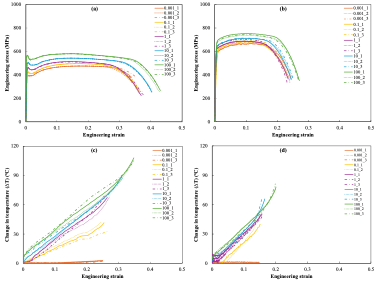

CONSTITUTIVE MODELING · CRYSTAL PLASTICITY · VALIDATION

# Physics-based micromechanical modeling for failure prediction in advanced high-strength steels.

I develop constitutive models from first principles, implement them as **Fortran material subroutines**, and validate them against **EBSD, DIC, infrared thermography, and mechanical tests**. My work connects microstructural mechanisms to component behavior in automotive forming, crash, and failure prediction.

[Explore my research](research.qmd){.btn-link-primary} [Download résumé](Sandip_Dayani_Resume.pdf){.btn-link} [View publications](publications.qmd){.text-link}

<i class="bi bi-geo-alt"></i> Kitchener-Waterloo, Canada · open to relocation
<i class="bi bi-mortarboard"></i> PhD · University of Waterloo · 2026

 Open to constitutive modeling & computational R&D roles

**Sandip Dayani, PhD**

Constitutive modeling · Multiscale validation · FEA

[<i class="bi bi-linkedin"></i> LinkedIn](https://www.linkedin.com/in/sandip-dayani/) [<i class="bi bi-mortarboard"></i> Scholar](https://scholar.google.ca/citations?user=zI0fpEwAAAAJ) [<i class="bi bi-github"></i> GitHub](https://github.com/sandipdayani)

PhD · 2026
Mechanical & Mechatronics Engineering

GM · sponsored
automotive materials research

0.001–100 s−1
strain rate range studied

3 journal articles
published in 2025 and 2026

FROM THEORY TO PREDICTION

## How I build and validate material models

I derive constitutive equations, implement them in a solver, and test their predictions against experiments. This makes it possible to check what each model assumption contributes.

01∂

### Constitutive theory
Finite deformation kinematics, free energy and dissipation, plasticity across strain rates and temperatures, and thermodynamically consistent damage.

Thermodynamics · Crystal plasticity

02{ }

### Solver implementation
Custom constitutive models implemented as Fortran UMAT/VUMAT subroutines in implicit and explicit finite element solvers.

Fortran · Abaqus · LS-DYNA

03◎

### Instrumented validation
Tests and model validation from microstructure and coupon response to component behavior across strain rates and temperatures.

EBSD · DIC · IR · V-bend

04↗

### Predictive acceleration
Constitutive model data and DeepONet surrogates to predict formability and mechanical response without repeating every full solver run.

Python · PyTorch · DeepONet

FEATURED RESEARCH

## Crystal plasticity damage modeling and validation

For HR340 and HR550 steels, I derived a thermodynamically consistent damage formulation, implemented strain rate dependence in a crystal plasticity model, and compared its predictions with measured stress–strain response, temperature rise, texture evolution, and damage.

**Published in:** *International Journal of Plasticity*, 186, 104255 (2025)

[See the research](research.qmd){.btn-link-primary} [Read the paper](https://doi.org/10.1016/j.ijplas.2025.104255){.btn-link}

{fig-alt="Four plots of engineering stress and temperature rise versus engineering strain at multiple strain rates"}

[Open full figure](assets/img/research/Experimental_stress-strain.png){.text-link}

RECENT PUBLICATIONS

## Recent journal articles

2026 · INTERNATIONAL JOURNAL OF PLASTICITY

**A thermomechanically coupled crystal plasticity damage model for quenching and partitioning steels: Effects of retained austenite stability, strain rates, and temperatures**

S. Dayani, W. Muhammad, A. Brahme, F. Hekmat, T. Sabiston, K. Wang, K. Inal

*International Journal of Plasticity*, vol. 207, 104856.

[DOI](https://doi.org/10.1016/j.ijplas.2026.104856){.text-link} [BibTeX](publications.qmd#bib-dayani2026qp){.text-link}

2026 · JOURNAL OF MATERIALS RESEARCH AND TECHNOLOGY

**Microstructure-informed thermomechanical crystal plasticity damage modeling of dual-phase steels**

S. Dayani, W. Muhammad, A. Brahme, F. Hekmat, T. Sabiston, K. Wang, K. Inal

*Journal of Materials Research and Technology*, vol. 45, pp. 1280–1305.

[DOI](https://doi.org/10.1016/j.jmrt.2026.09.134){.text-link} [BibTeX](publications.qmd#bib-dayani2026dp){.text-link}

[View all publications](publications.qmd){.text-link}

LATEST

## Milestones

OCT 2026
Published a paper on quenching and partitioning steels in *International Journal of Plasticity*.

SEP 2026
Published a paper on dual phase steels in *Journal of Materials Research and Technology*.

AUG 2026
Defended my PhD thesis at the University of Waterloo.

[All updates →](news.qmd){.text-link}

COLLABORATION

## Building a material model that must work beyond its calibration curves?

[Discuss the problem](mailto:sandip.dayani09@gmail.com){.btn-light}

