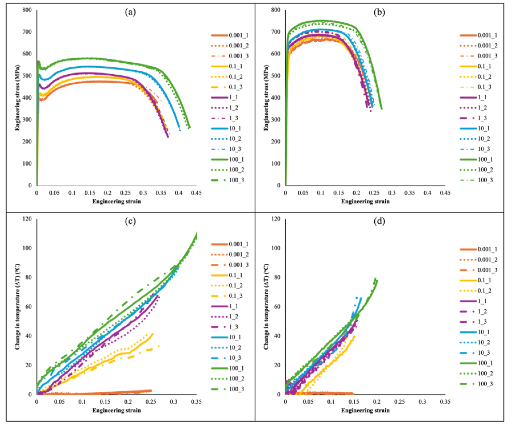
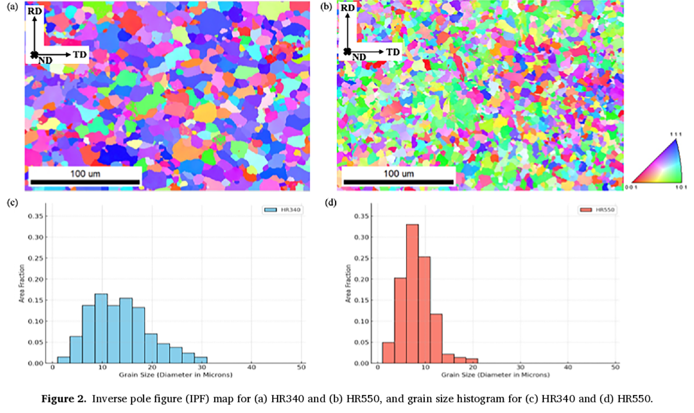
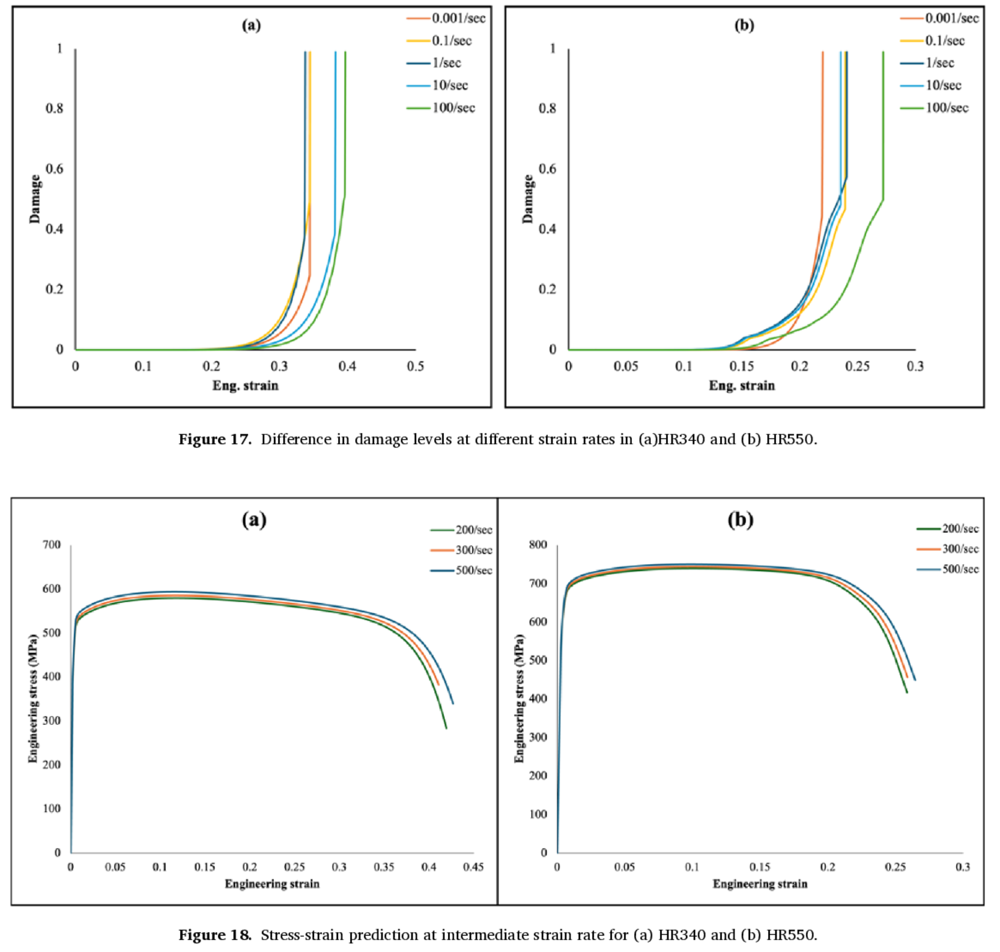
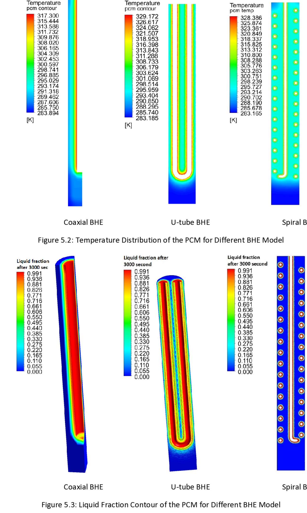
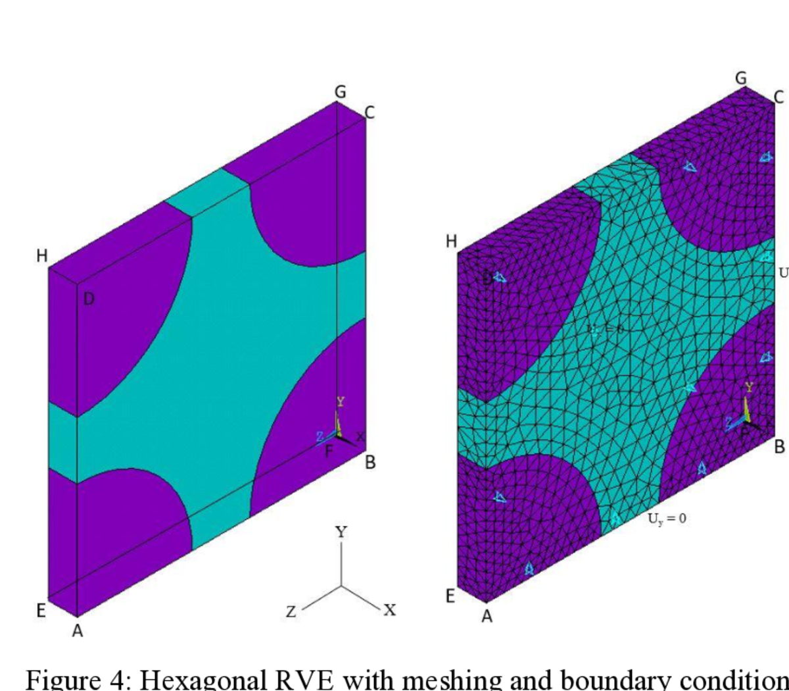
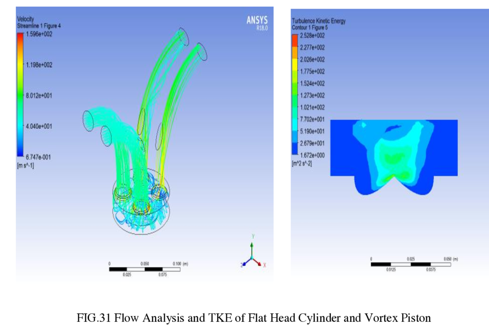

::: {.page-intro}
I work on computational models that connect grain-scale mechanisms to engineering-scale failure. The research thread is consistent across my PhD and earlier projects: use simulation, experiments, and material physics to explain why a structure deforms, localizes, heats up, and eventually fails.
:::

For automotive R&D, this matters because advanced high-strength steels are valuable only if their formability and crash performance can be predicted before expensive trial-and-error testing. My current work builds toward that goal by combining crystal plasticity, damage mechanics, thermal coupling, high-rate testing, and ML-ready features for forming-limit prediction.

## PhD: Crystal Plasticity Damage in HSLA Steel

::: {.research-hero}
::: {.research-hero-copy}
### Thermodynamically consistent CP damage model
I developed and implemented a rate-dependent crystal-plasticity damage model for HR340 and HR550 HSLA steels. The formulation adds damage evolution and internal temperature rise into the constitutive framework, so the model can capture post-necking softening and failure instead of only fitting uniform plastic flow.

**Core mechanisms:** crystallographic slip, void nucleation, void growth, damage coalescence, dislocation-density evolution, texture evolution, and plastic-dissipation-driven heating.

**Output:** Dayani et al., *International Journal of Plasticity*, 2025. [DOI](https://doi.org/10.1016/j.ijplas.2025.104255)
:::

::: {.research-hero-figure}
{fig-alt="Stress-strain and temperature response for HR340 and HR550 steels at multiple strain rates"}
:::
:::

## Experimental Validation

::: {.research-panel}
::: {.research-panel-figure}
{fig-alt="EBSD inverse pole figure maps and grain size histograms for HR340 and HR550 steels"}
:::

::: {.research-panel-copy}
### Microstructure, strain, and temperature measured together
The model is grounded in measured material behavior rather than curve-fitting alone. EBSD was used to characterize HR340 and HR550 microstructure and texture. Tensile tests were performed across quasi-static and intermediate strain rates. DIC captured local strain evolution, while high-speed IR thermography tracked temperature rise near localization and fracture.

This gives a closed validation loop: microstructure informs the CP model, DIC and stress-strain data calibrate deformation behavior, and IR data checks whether the thermo-mechanical coupling is physically reasonable.
:::
:::

## Predictive Modeling

::: {.research-panel reverse}
::: {.research-panel-figure}
{fig-alt="Crystal-plasticity damage evolution and intermediate strain-rate stress-strain predictions"}
:::

::: {.research-panel-copy}
### From fitted curves to mechanism-aware predictions
The CP damage model predicts stress-strain response at uncalibrated strain rates, damage accumulation across HR340 and HR550, and the delay in damage onset as strain rate increases. It also captures texture evolution and links internal temperature rise to dislocation recovery and softening.

The practical value is not just a better plot. It is a route toward reliable material models for crash simulations and toward physics-informed inputs for ML-based FLD prediction.
:::
:::

::: {.method-grid}
::: {.method-card}
### Inputs
EBSD texture, grain-size distributions, tensile data, DIC strain fields, IR temperature measurements.
:::

::: {.method-card}
### Model
Rate-dependent BCC crystal plasticity with thermodynamic damage evolution and internal heat generation.
:::

::: {.method-card}
### Outputs
Stress-strain response, temperature rise, damage evolution, texture evolution, and fracture-sensitive trends.
:::
:::

## Earlier Computational Work

::: {.project-grid}
::: {.project-card}
{fig-alt="Temperature and liquid-fraction contours for borehole heat exchanger models with PCM backfill"}

### PCM Borehole Heat Exchangers
Master thesis at TU Chemnitz / Fraunhofer UMSICHT. Built and validated transient CFD models of coaxial, U-tube, and spiral borehole heat exchangers using water and PCM as backfill. The spiral BHE showed stronger thermal response than coaxial and U-tube designs under the studied conditions.

*Source: MSc thesis, 2021.*
:::

::: {.project-card}
{fig-alt="Hexagonal representative volume element with mesh and boundary conditions for fiber-reinforced composites"}

### FRP Micromechanics and RVE Modeling
Master research project at TU Chemnitz. Modeled E-glass/PA6 and carbon/PA6 composites using representative volume elements in ANSYS to compare linear and nonlinear elastic behavior and estimate effective engineering constants.

*Source: Master research project, 2019.*
:::

::: {.project-card}
{fig-alt="ANSYS CFD flow and turbulence kinetic energy result for diesel engine combustion chamber geometry"}

### Diesel Engine Combustion CFD
Bachelor project at Gujarat Technological University. Compared combustion chamber and piston geometries using CFD flow and turbulence metrics. The flat-head cylinder with vortex piston gave the strongest flow/TKE response among the tested geometries.

*Source: Bachelor project report, 2017.*
:::
:::

## Direction

::: {.direction-panel}
The next step is to connect physics-based simulation and data-driven prediction more tightly. For FLD prediction, the useful path is not a black-box model alone. The stronger path is to feed ML models with features that already carry physical meaning: microstructure, texture, phase fraction, strain path, strain rate, temperature rise, damage indicators, and calibrated constitutive response.
:::
